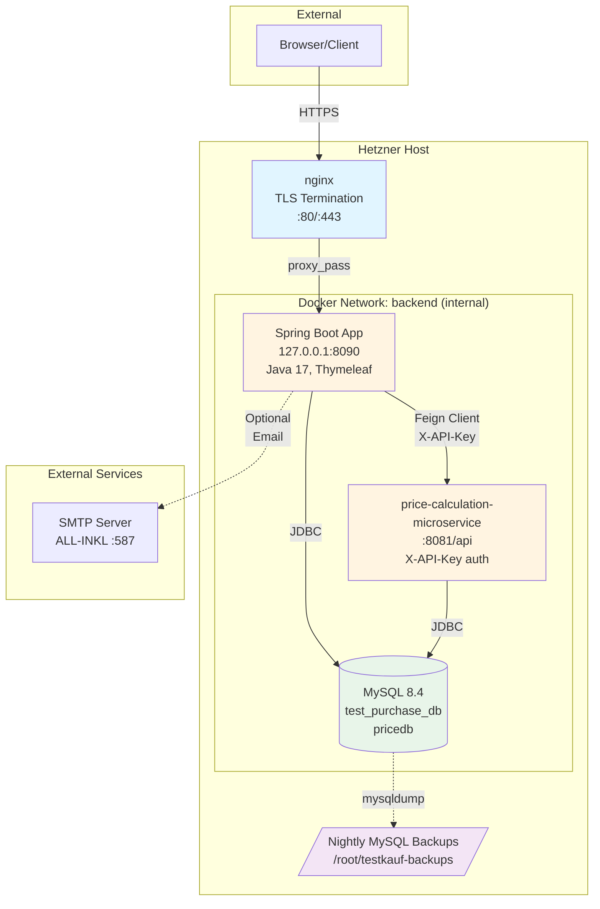

# Architecture

This document describes the technical architecture of the Test Purchase Application.

## System Overview

The application uses a microservices-oriented architecture with a monolithic Spring Boot application for business logic and a separate pricing calculation service.



## Components

### 1. Nginx Reverse Proxy

- **Purpose**: TLS termination and reverse proxy
- **Location**: Host system (not in Docker)
- **Ports**: 80 (HTTP redirect), 443 (HTTPS)
- **Configuration**: `/etc/nginx/sites-available/testkauf.getinweb.de.conf`
- **TLS**: Let's Encrypt certificates via Certbot
- **Upstream**: Proxies to `127.0.0.1:8090` (Spring Boot app)

### 2. Spring Boot Application

- **Technology**: Java 17, Spring Boot 3, Thymeleaf
- **Port**: 127.0.0.1:8090 (not publicly exposed)
- **Responsibilities**:
  - Web UI and REST endpoints
  - Authentication and authorization (Spring Security)
  - Business logic for test purchases, customers, shops, users
  - File upload handling (avatars, attachments)
  - Email notifications (optional SMTP)
  - Internationalization (Bulgarian, English, German)
- **Database**: Connects to MySQL via JDBC (`test_purchase_db`)
- **External Services**: 
  - Pricing microservice via Feign client (with `X-API-Key` header)
  - Optional SMTP for password resets and notifications
- **Health Check**: Spring Actuator `/actuator/health`

### 3. Price Calculation Microservice

- **Technology**: Separate Spring Boot service
- **Repository**: [mitetodb/price-calculation-microservice](https://github.com/mitetodb/price-calculation-microservice)
- **Port**: 8081 (internal Docker network only)
- **API Endpoint**: `/api/v1/prices/calculate`
- **Authentication**: `X-API-Key` header (shared secret)
- **Responsibilities**:
  - Calculate service fees
  - Calculate postage costs
  - Business rules for pricing logic
- **Database**: Connects to MySQL (`pricedb`)

### 4. MySQL Database

- **Version**: MySQL 8.4
- **Databases**:
  - `test_purchase_db` - Main application database
  - `pricedb` - Pricing service database
- **Network**: Internal Docker network only (no published ports)
- **Users**: Least-privilege users per service
- **Migrations**: Flyway (main app) for schema versioning
- **Backups**: Automated nightly backups via `deploy/backup-mysql.sh`

### 5. Backup System

- **Script**: `deploy/backup-mysql.sh`
- **Schedule**: Cron (typically 3:15 AM daily)
- **Location**: `/root/testkauf-backups/`
- **Format**: Gzipped SQL dumps
- **Retention**: 14 days (configurable)
- **Permissions**: Files created with mode 600 (owner only)

## Network Architecture

### Docker Network: `backend` (Internal)

All services communicate through an internal Docker network named `backend`:

- **app** ↔ **db**: JDBC connection
- **pricing-svc** ↔ **db**: JDBC connection  
- **app** ↔ **pricing-svc**: HTTP with `X-API-Key` authentication

No services expose ports directly to the host except:
- **app**: `127.0.0.1:8090` (localhost only, for nginx proxy)

### Security Model

1. **TLS Termination**: nginx handles HTTPS, proxies plain HTTP internally
2. **Localhost Binding**: Spring Boot only listens on 127.0.0.1
3. **Network Isolation**: MySQL and pricing service have no external exposure
4. **Authentication Layers**:
   - Browser → nginx: HTTPS
   - nginx → app: localhost HTTP
   - app → pricing-svc: `X-API-Key` header
   - Services → MySQL: Database credentials

## Data Flow Examples

### 1. Test Purchase Creation

```
User (Browser) 
  → nginx (HTTPS)
  → Spring Boot app (validates, saves to DB)
  → Pricing service (Feign call with X-API-Key)
  → Pricing service queries pricedb
  ← Returns calculated price
  ← Spring Boot saves complete purchase
  ← Returns HTML page
```

### 2. File Upload (Avatar/Attachment)

```
User (Browser)
  → nginx (HTTPS)
  → Spring Boot app
    - Validates file type and size
    - Saves to local filesystem (/opt/testkauf/uploads/)
    - Stores file path in MySQL
  ← Returns success response
```

### 3. Password Reset

```
User requests reset
  → Spring Boot generates token
  → Saves token in MySQL
  → Sends email via SMTP (if enabled)
User clicks link
  → Spring Boot validates token
  → User sets new password
  → Token invalidated
```

## Deployment Architecture

### File Structure on Host

```
/opt/testkauf/
├── test-purchase-application/
│   ├── deploy/
│   │   ├── .env                          # Secrets (chmod 600)
│   │   ├── docker-compose.prod.yml       # Production stack
│   │   ├── backup-mysql.sh               # Backup script
│   │   └── nginx/
│   │       └── testkauf.getinweb.de.conf
│   └── ...
├── price-calculation-microservice/
│   └── ...
└── uploads/                              # User uploads volume

/root/testkauf-backups/                   # MySQL backups
├── test_purchase_db_20261029_0315.sql.gz
├── pricedb_20261029_0315.sql.gz
└── ...

/etc/nginx/sites-available/
└── testkauf.getinweb.de.conf             # Symlinked to sites-enabled
```

### Docker Compose Services

```yaml
services:
  app:                  # Main Spring Boot application
  pricing-svc:          # Pricing microservice
  db:                   # MySQL 8.4
  mailpit:              # Optional mail testing (--profile mail)
```

All services have:
- Memory limits (`mem_limit`)
- Health checks
- Restart policies (`unless-stopped`)

## Technology Stack

| Layer | Technology |
|-------|-----------|
| **Frontend** | Thymeleaf, Bootstrap, JavaScript |
| **Backend** | Spring Boot 3, Java 17 |
| **Security** | Spring Security (role-based) |
| **Database** | MySQL 8.4 |
| **ORM** | Hibernate/JPA |
| **Migrations** | Flyway |
| **API Communication** | Spring Cloud OpenFeign |
| **API Documentation** | SpringDoc OpenAPI |
| **Containerization** | Docker, Docker Compose |
| **Reverse Proxy** | nginx |
| **TLS** | Let's Encrypt (Certbot) |
| **Email** | Spring Mail (JavaMail) |
| **Build Tool** | Maven 3.9 |

## Configuration Management

All configuration is environment-based (12-factor app):

- **Secrets**: `.env` file (never committed)
- **Profiles**: `SPRING_PROFILES_ACTIVE=prod`
- **Database URLs**: Environment variables
- **API Keys**: `PRICING_API_KEY` environment variable
- **Feature Flags**: `DEMO_DATA_ENABLED`, `SWAGGER_ENABLED`, `MAIL_ENABLED`

## Monitoring and Health

- **Spring Actuator**: `/actuator/health` endpoint
- **Docker Health Checks**: All services have health checks
- **Logs**: Docker logs via `docker compose logs`
- **Backup Monitoring**: Cron logs to `/var/log/testkauf-backup.log`

## Scalability Considerations

Current architecture is single-host, single-instance:

- **Database**: Single MySQL instance with two databases
- **Application**: Single Spring Boot instance
- **File Storage**: Local filesystem

For future scaling:
- Load balancer with multiple app instances
- Shared storage (NFS/S3) for uploads
- Database replication or managed service
- Redis for session management
